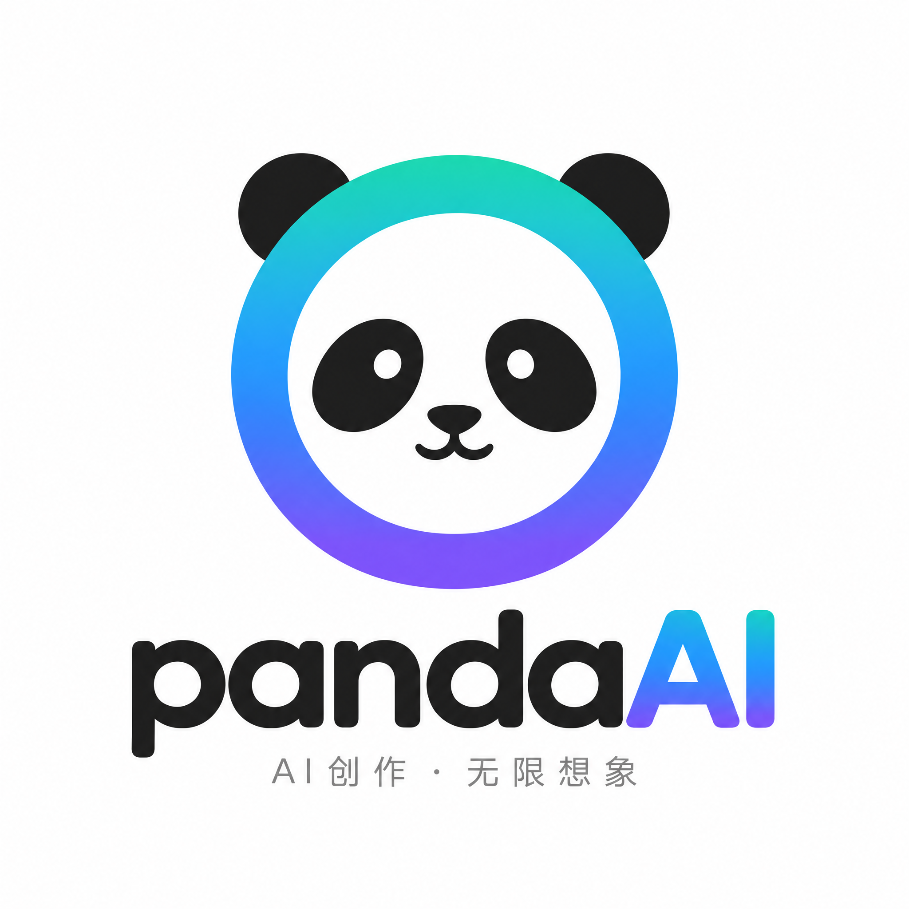
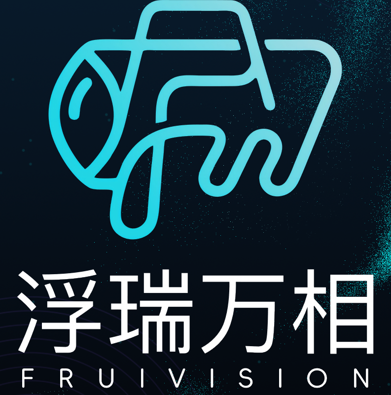
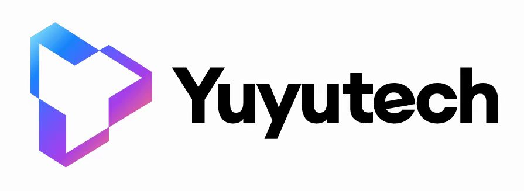
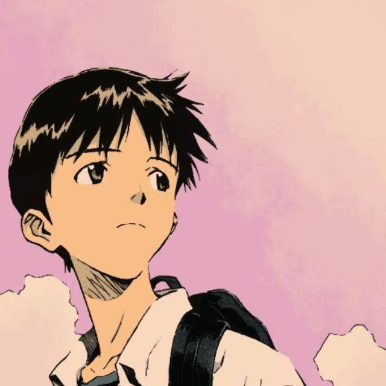
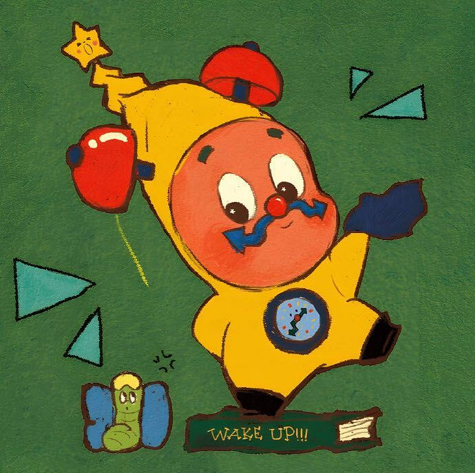
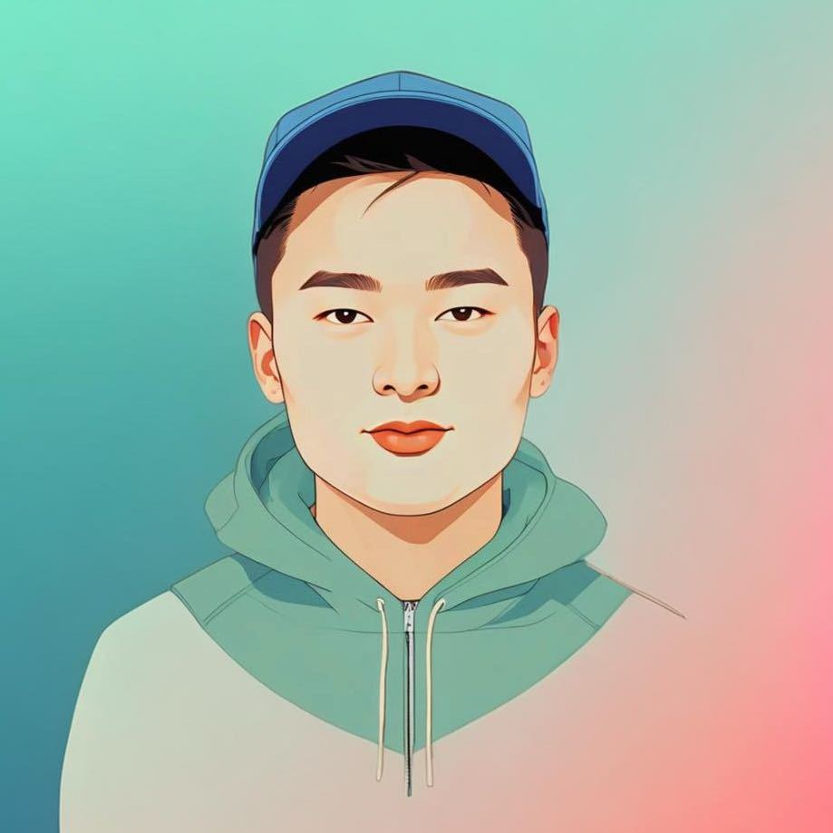
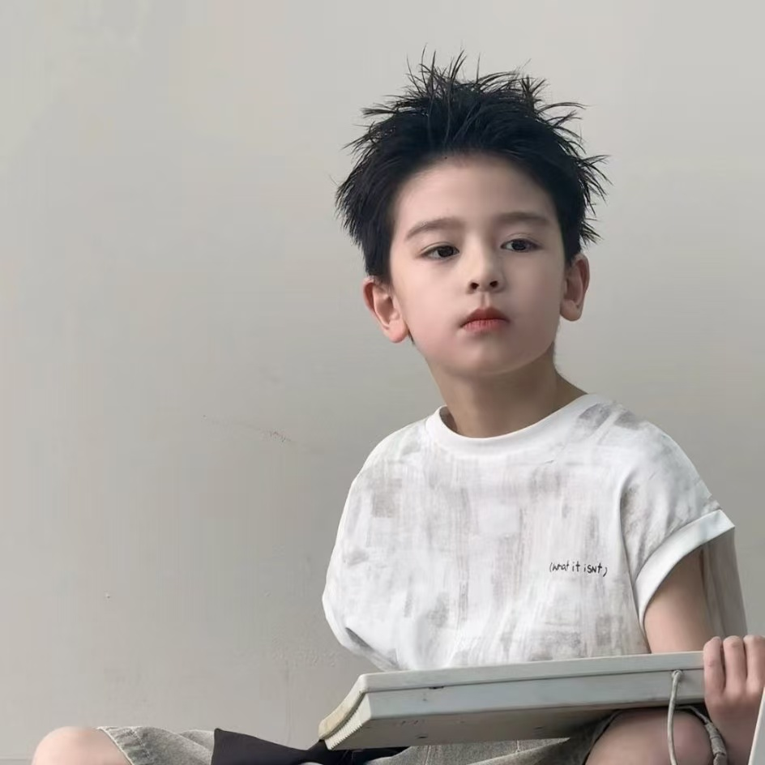
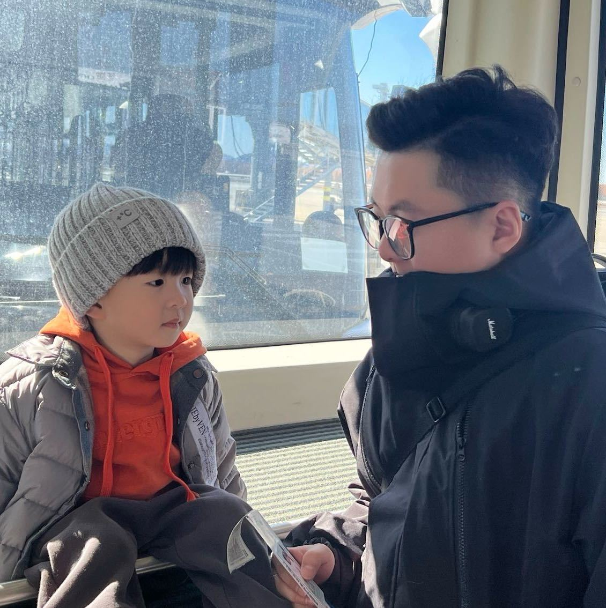
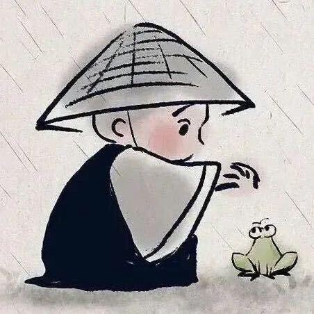
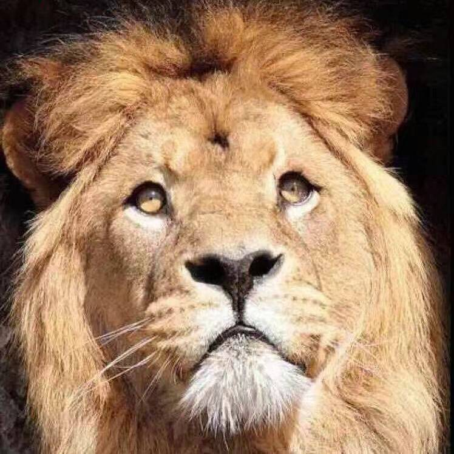

<p align="center">
  
</p>

<h1 align="center">映雪</h1>

<p align="center">为 AI 影视与短剧创作打造的一体化生产工作台</p>

<p align="center">
  <a href="https://tianyayingxue.cn">在线使用</a> ·
  <a href="docs/content/docs/overview/features.mdx">功能说明</a> ·
  <a href="docs/index.md">项目文档</a> ·
  <a href="SECURITY.md">安全策略</a>
</p>

映雪围绕影视内容的实际生产过程设计：从故事构思、角色与场景设定，到分镜编排、图片与视频生成，再到素材归档和任务追踪，都可以在同一个工作区内完成。它不是单一的生成工具，而是一套让创意、镜头和素材持续衔接的创作环境。

当前隔离同步候选基线为上游 main `0b1d5073`，尚未回写主会话运行目录。项目仍在快速迭代，数据结构和外部接口可能调整；生产使用前请完成安全配置与升级验证。

## 映雪能做什么

- **把故事拆成可执行镜头**：整理剧本、角色、场景、风格和参考素材，在画布中编排分镜关系。
- **在一处完成多媒体生成**：统一发起文本、图片、视频和音频任务，支持参考图、首尾帧、视频续写和批量生成等流程。
- **让素材跟着项目走**：集中管理生成结果、上传素材、任务日志和业务引用，减少文件散落与版本混乱。
- **连接不同模型渠道**：通过系统渠道、自定义渠道和逻辑模型组织生成能力，由后端中转敏感请求。
- **让 Agent 参与创作**：借助本地 Canvas Agent、MCP 和 Codex 插件，让 AI 助手理解并操作当前画布。
- **支持个人部署与团队管理**：提供账号、权限、额度、任务队列、对象存储和管理后台等基础能力。

完整能力与当前实现状态见[功能说明](docs/content/docs/overview/features.mdx)。

## 上游赞助致谢

感谢以下赞助商对影策项目的支持：

| LOGO | 类型 | 赞助商名称 | 说明 | 网站 |
| --- | --- | --- | --- | --- |
|  | 商业 | ArtDance | 影策项目天使投资人 - `关门人·克里斯` | [artbox.top](https://artbox.top) |
|  | 企业 | 秘塔 | 提供 MiniMax H3 视频生成 API，支持原生 2K、音画同步和 OpenAI 兼容协议。`影策官方H3模型唯一合作伙伴！` | [metaso.cn](https://metaso.cn/minimax-h3/?s=dd) |
|  | 商业 | 源点动力 | 专注 Seedance、Wan 等视频模型 API，以更优惠的价格降低成本。部分模型个人三折，企业二折，做人民用得起的供应商。 | [ai.tack2ai.cn](https://ai.tack2ai.cn) |
|  | 团队 | panda AI | API接口平台，面向个人开发者、技术团队与企业，稳定提供GPT、Gemini、grok等图片视频模型 | [api.pandatk.com](https://api.pandatk.com) |
|  | 商业 | bbkingBra API | 以稳定算力，承载漫剧每一段故事 | [newapi.bobby707.xyz](https://newapi.bobby707.xyz) |
|  | 商业 | Yuxi AI | 面向个人创作者、漫剧工作室、企业，提供稳定 Seedance 等视频模型 API，做漫剧创作者高性价比的视频供应方。 | [yuxibox.xyz](https://yuxibox.xyz) |

--------

| LOGO | 类型 | 赞助商名称 | 说明 | 网站 |
| --- | --- | --- | --- | --- |
|  | 商业 | soonstudio | API 一站式网站，自研系统，非 New API；支持手机、短信接码，覆盖国内外几乎所有模型 API 接口，并发高、稳定性强。源于开源，步入 AI 领域，感谢开源。 | [soonstudio.ai](https://soonstudio.ai/) |
|  | 团队 | 快乐机艺术小组 | 一支跨学科的艺术创作团队，持续探索数字与艺术的全新表达形式。 | 暂无 |
|  | 企业 | 浮瑞万相AI | 一家专注于AI视听的AI Native公司 | 暂无 |
|  | 企业 | 羽宇科技 | 一站式AI应用平台。提供模型算力入口、AI短剧视频制作（Studio）、企业数字员工（Agent）及内容出海（OPC）全栈解决方案。 | 暂无 |

### 3D 预演台赞助用户

感谢以下用户赞助 3D 预演台的开发：

<p>
  <a href="https://github.com/TripsCoder"></a>
  <a href="https://github.com/sugtex"></a>
  <a href="https://github.com/Leyi813"></a>
  <a href="https://github.com/daoge05178"></a>
  <a href="https://github.com/AetherNo2332"></a>
</p>

GitHub 用户：[@TripsCoder](https://github.com/TripsCoder) · [@sugtex](https://github.com/sugtex) · [@Leyi813](https://github.com/Leyi813) · [@daoge05178](https://github.com/daoge05178) · [@AetherNo2332](https://github.com/AetherNo2332)

| 赞助用户 | 联系方式 |
| --- | --- |
| vv | 2838033228@qq.com |
| 克里斯 | [artbox.top](https://artbox.top) |
| 宇熙 | 53121904@qq.com |
| 落羽 | luoyyv66@gmail.com |
| 今夕何在 | 809321478@qq.com |
| Alpha-M·Break | 15739564793@qq.com |
| 不吃鸭梨 | elio02519@gmail.com |
| 九月 | 563641352@qq.com |
| A | jaiboxuan1205@gmail.com |

## 工作方式

- **自由画布**：节点、连线、框选、缩放、小地图、撤销重做、导入导出和只读分享。
- **影视创作工作流**：剧本、角色、场景、风格板、参考素材、结构化分镜和 3D 导演台。
- **多媒体生成**：文本、图片、视频、音频任务，支持参考图、首尾帧、运镜、续写、局部修改和批量生成。
- **任务与素材管理**：异步队列、进度与日志、取消/重试、素材库、资源引用校验和登录后的跨设备同步。
- **时间线剪辑**：片段编排、拆分、修剪、字幕转写和服务端成片导出，并支持插件化编辑面板。
- **云端 Agent**：支持持久化对话、画布摘要和流式事件回放；当前为只读阶段，真实环境能力以文档和验收清单为准。
- **Agent 技能生态**：内置技能覆盖生产流程；社区技能库 [judian-skills](https://github.com/itsWyatt-K/judian-skills) 提供 34 个场景域包索引，完整卡片通过 GitHub 安装后按需读取。安装：技能页 → 安装技能 → GitHub 标签 → 仓库地址填 `https://github.com/itsWyatt-K/judian-skills`，子目录填 `skills/drama/story-structure-engine` 这类域包路径。
- **管理与渠道**：系统渠道、逻辑模型、用量/积分、功能开关、对象存储、响应拦截和管理后台。


```text
故事与创意
   ↓
角色 / 场景 / 风格资产
   ↓
自由画布与结构化分镜
   ↓
图片 / 视频 / 音频生成
   ↓
任务追踪、素材复用与项目交付
```

网页工作区负责创作和画布交互；Go 后端负责登录、权限、任务、资源和模型中转；本地 Canvas Agent 负责连接浏览器画布与本机 AI 工具。各模块可以独立开发，也可以组合为完整服务。

前端默认把 `/api` 代理到 `http://127.0.0.1:8080`；生产环境由网页容器的 Nginx 代理到后端，只有 web 的 `3000` 端口需要对外暴露。信封和错误码见 [HTTP API](docs/content/docs/backend/http-api.mdx)。系统模型和文本任务的 SSE 只在明确的流式路径关闭代理缓冲，详见 [`nginx.conf`](nginx.conf) 和 [SSE 与本地部署文档](docs/content/docs/backend/local-development.mdx)。

## 快速开始

### 本机开发

需要准备：

- Bun
- Go 1.25
- Node.js 18+（仅 Canvas Agent 需要）

```bash
git clone https://github.com/luxueqi123/open-ai-canvas.git
cd open-ai-canvas
```

Windows PowerShell 可在仓库根目录运行：

```powershell
.\scripts\start-local.ps1
```

脚本会把调试数据放在 Git 忽略的 `.local/project-workbench-debug`，并分别启动前端与后端。首次打开 <http://localhost:3000> 后，可注册首个管理员账号，再到设置中配置模型渠道。

也可以分别启动：

```bash
# 终端一：后端
cd backend
CANVAS_BACKEND_DATA_DIR=../.local/project-workbench-debug go run ./cmd/server

# 终端二：前端
cd web
bun install
bun run dev
```

详细环境变量和排障方法见[本地开发文档](docs/content/docs/backend/local-development.mdx)。

### Docker 运行

本地构建前后端镜像：

```bash
docker compose -f docker-compose.local.yml up -d --build
```

源码热更新开发：

```bash
LOCAL_UID=$(id -u) LOCAL_GID=$(id -g) \
  docker compose -f docker-compose.dev.yml up --build
```

生产部署使用 PostgreSQL、Redis、后端和 Web 四个服务：

```bash
docker compose --env-file .env \
  -f docker-compose.deploy.yml \
  -f docker-compose.build.yml up -d --build
```

生产环境只需公开 Web 端口；后端 `8080` 应保留在 Compose 网络内。部署前请根据 `.env.example` 配置 HTTPS、跨域来源、数据目录和注册开关。内置技能的案例图片、视频和封面通过 `CANVAS_SKILL_MEDIA_PATH` 从宿主机数据盘只读挂载，不应写入容器可写层。

## 架构概览

```text
浏览器（web/）
  ├─ React 工作区、画布、任务中心和素材库
  ├─ Zustand / localForage 本地状态与降级缓存
  └─ 登录态 API、资源请求和 SSE
          │
          ▼
后端（backend/）
  ├─ Gin handler -> service -> repository/model
  ├─ SQLite（本地）或 PostgreSQL + Redis（部署）
  ├─ 异步任务 worker、权限、资源存储和模型中转
  └─ provider / outbound -> 外部模型渠道
```

前端业务 API 统一经 `web/src/services/api/request.ts` 调用。生产环境由 Nginx 托管前端并代理后端，公网只需暴露 web 入口；SSE 仅在明确的流式路径关闭代理缓冲。

## 服务器部署

### 源码构建（推荐）

适用于 Linux 云服务器。脚本会安装 Docker、拉取源码、生成受保护的 `.env`，并启动 PostgreSQL、Redis、后端和网页：

```bash
curl -fsSL https://raw.githubusercontent.com/ddcat-ai/open-ai-canvas/main/scripts/install-server.sh | sudo bash
```

默认访问 `http://服务器IP:3000`。更新或排查：

```bash
cd /opt/open-ai-canvas
sudo docker compose --env-file .env \
  -f docker-compose.deploy.yml -f docker-compose.build.yml ps
sudo docker compose --env-file .env \
  -f docker-compose.deploy.yml -f docker-compose.build.yml logs -f --tail=200
```

### 使用 GHCR 镜像

不需要源码时，可使用镜像部署脚本：

```bash
curl -fsSL https://raw.githubusercontent.com/ddcat-ai/open-ai-canvas/main/scripts/install-server-image.sh \
  | sudo env CANVAS_IMAGE_TAG=v1.5.7.1 bash
```

脚本会先按指定 Release 拉取镜像，再解析并写入 `CANVAS_BACKEND_IMAGE`、`CANVAS_WEB_IMAGE` 的 GHCR digest；生产 Compose 不接受缺失 digest 的默认镜像或 `latest`。更新流程、数据库迁移、备份和回退说明见[系统更新文档](docs/content/docs/backend/system-update.mdx)。

## 安全边界

- 首次管理员注册应在受控网络完成，公网部署保持 `CANVAS_REGISTRATION_ENABLED=false`。
- 设置准确的 `CANVAS_CORS_ORIGINS`，不要在公网使用 `*`；使用 HTTPS 并正确转发代理头。
- 后端默认拒绝本机、私网和链路本地模型地址。开发时只通过 `CANVAS_ALLOWED_PRIVATE_UPSTREAM_HOSTS` 精确放行可信主机，不要使用全量放行开关。
- 用户 API Key 不应出现在 URL、日志、错误上报或服务端长期明文存储中；只在可信部署和 HTTPS 链路中使用真实密钥。
- 后端 `8080` 应留在 Compose 网络内，不要直接暴露到公网；限制 `.env`、数据库、上传目录、备份和 `.settings-key` 的权限。
- 媒体资源可使用后端数据目录、阿里云 OSS 或腾讯云 COS；删除素材前会检查业务引用。

安全问题请按 [`SECURITY.md`](SECURITY.md) 报告，不要在公开 Issue 中粘贴密钥、Cookie、数据库或生产日志。

## 项目结构

| 目录 | 作用 |
| --- | --- |
| `web/` | React 工作区、画布交互、模型协议适配和浏览器缓存 |
| `backend/` | Go API、账号权限、任务队列、资源管理和模型中转 |
| `canvas-agent/` | 本机 Agent、MCP、画布会话桥接和本地渠道 |
| `plugins/yingce/` | 映雪的 Codex App 插件与技能 |
| `docs/` | 用户、开发、部署和设计专题文档 |

代码边界与协作规则见 [`AGENTS.md`](AGENTS.md)，文档入口见 [`docs/index.md`](docs/index.md)。

## 开发验证

根据改动范围选择对应命令：

```bash
# 前端
cd web && bun run lint && bun run build

# 后端
cd backend && go test ./...

# Canvas Agent
cd canvas-agent && bun run test && bun run build

# 文档站
cd docs && bun run types:check
```

UI 改动还应检查关键路由、明暗主题、弹窗、滚动、空态和核心交互。当前待验证事项记录在[待测试清单](docs/content/docs/progress/pending-test.mdx)。

## 文档导航

完整文档索引见 [`docs/index.md`](docs/index.md)。

- [功能清单](docs/content/docs/overview/features.mdx)
- [本地开发](docs/content/docs/backend/local-development.mdx)
- [插件系统](docs/content/docs/plugins/plugin-system.mdx)
- [待测试清单](docs/content/docs/progress/pending-test.mdx)
- [工作区设计](docs/design/workspace-shell-design.mdx)
- [更新日志](CHANGELOG.md) · [贡献指南](CONTRIBUTING.md) · [上游声明](NOTICE)

## 交流与反馈

Issue 反馈、技术讨论和产品升级建议可以在微信交流群中沟通；群内也会不定期组织 AI 学习与培训交流会。

<p align="center">
  
</p>

## 许可证和上游

映雪是独立维护的二次开发项目，基于 [`ddcat-ai/open-ai-canvas`](https://github.com/ddcat-ai/open-ai-canvas) 继续开发；相关早期画布实现来源于 [`basketikun/infinite-canvas`](https://github.com/basketikun/infinite-canvas)。

项目遵循 [MIT License](LICENSE)。原项目作者与贡献者的版权和署名按许可证要求保留，具体见 [`LICENSE`](LICENSE) 与 [`NOTICE`](NOTICE)。

上游项目的赞助商与贡献者致谢一并保留在下方。

---

## 贡献者与团队

感谢参与产品设计、开发、测试、内容和社区建设的成员。以下为紧凑展示，完整保留每位成员的头像、昵称、联系方式和个性签名：

<table>
<tr>
<td width="50%" valign="top">
  
  <strong>ddCat<br><sub>项目发起者 · 微信：ddcat0829</sub></strong><br>
  <a href="mailto:ddcat666@126.com">ddcat666@126.com</a><br>
  <em>在计算机里头没有任何黑魔法，所有的东西只不过是我现在不知道而已，总有一天我会把所有的细节、所有的内部的东西全搞明白的。</em>
  <br clear="left">
</td>
<td width="50%" valign="top">
  
  <strong>爱笑的毛毛虫<br><sub>用户名：sikongyue</sub></strong><br>
  <a href="mailto:315515767@qq.com">315515767@qq.com</a><br>
  <em>正在啃 main 分支，争取下次 merge 的时候变成蝴蝶</em>
  <br clear="left">
</td>
</tr>
<tr>
<td width="50%" valign="top">
  
  <strong>delve-s</strong><br>
  <a href="mailto:3013141136@qq.com">3013141136@qq.com</a><br>
  <em>我亦无他，惟手熟尔</em>
  <br clear="left">
</td>
<td width="50%" valign="top">
  
  <strong>CyrusAuyeung</strong><br>
  <a href="mailto:cyrusauyeungho@gmail.com">cyrusauyeungho@gmail.com</a><br>
  <em>HKUST(GZ) UG</em>
  <br clear="left">
</td>
</tr>
<tr>
<td width="50%" valign="top">
  
  <strong>奶大佬</strong><br>
  <a href="mailto:1304634970@qq.com">1304634970@qq.com</a><br>
  <em>人生就是要不断的探索</em>
  <br clear="left">
</td>
<td width="50%" valign="top">
  
  <strong>dyh</strong><br>
  <a href="mailto:1613203335@qq.com">1613203335@qq.com</a><br>
  <em>无</em>
  <br clear="left">
</td>
</tr>
<tr>
<td width="50%" valign="top">
  
  <strong>kyori</strong><br>
  <a href="mailto:1771634408@qq.com">1771634408@qq.com</a><br>
  <em>励志成为未来最好用的画布仓库的贡献者</em>
  <br clear="left">
</td>
<td width="50%" valign="top">
  
  <strong>Bowen</strong><br>
  <a href="mailto:admin@bowen.games">admin@bowen.games</a><br>
  <em>剑走偏峰，雷厉风行。</em>
  <br clear="left">
</td>
</tr>
<tr>
<td width="50%" valign="top">
  
  <strong>ken</strong><br>
  <a href="mailto:2506802@qq.com">2506802@qq.com</a><br>
  <em>走自己的路</em>
  <br clear="left">
</td>
<td width="50%" valign="top">
  
  <strong>fish</strong><br>
  <a href="mailto:cihai.sea@gmail.com">cihai.sea@gmail.com</a><br>
  <em>AI 界热于助人的拖油瓶</em>
  <br clear="left">
</td>
</tr>
<tr>
<td width="50%" valign="top">
  
  <strong>QAyong<br><sub>ID：QAyong<br>B站：QAyong</sub></strong><br>
  <a href="mailto:2110491559@qq.com">2110491559@qq.com</a><br>
  <em>AI 短剧合规，资产确权</em>
  <br clear="left">
</td>
<td width="50%" valign="top">
  
  <strong>_K37ix.</strong><br>
  <a href="mailto:2773843782@qq.com">2773843782@qq.com</a><br>
  <em>Making things that think</em>
  <br clear="left">
</td>
</tr>
<tr>
<td width="50%" valign="top">
  
  <strong>Rou</strong><br>
  <a href="mailto:rou325089@163.com">rou325089@163.com</a><br>
  <em>上善若水</em>
  <br clear="left">
</td>
<td width="50%" valign="top">
  
  <strong>vv<br><sub>dy/xhs：荣灵</sub></strong><br>
  <a href="mailto:2838033228@qq.com">2838033228@qq.com</a><br>
  <em>就是水水</em>
  <br clear="left">
</td>
</tr>
<tr>
<td width="50%" valign="top">
  
  <strong>Dominic1556</strong><br>
  <a href="mailto:184026530@qq.com">184026530@qq.com</a><br>
  <em>Done is better than perfect</em>
  <br clear="left">
</td>
<td width="50%" valign="top">
  
  <strong>宇熙</strong><br>
  <a href="mailto:53121904@qq.com">53121904@qq.com</a><br>
  <em>年轻的时候不狂，老了拿什么回忆</em>
  <br clear="left">
</td>
</tr>
<tr>
<td width="50%" valign="top">
  
  <strong>影子</strong><br>
  <a href="mailto:305818148@qq.com">305818148@qq.com</a><br>
  <em>年纪大佬才明白人要顺势而为。</em>
  <br clear="left">
</td>
<td width="50%" valign="top">
  
  <strong>Ray</strong><br>
  <a href="mailto:cnraylee@qq.com">cnraylee@qq.com</a><br>
  <em>AI时代的全栈落地工，欢迎找我聊需求</em>
  <br clear="left">
</td>
</tr>
<tr>
<td width="50%" valign="top">
  
  <strong>不见山谷<br><sub>VV：yu170718</sub></strong><br>
  <a href="mailto:1762202553@qq.com">1762202553@qq.com</a><br>
  <em>空山不见人，但闻人语响</em>
  <br clear="left">
</td>
<td width="50%" valign="top">
  
  <strong>yep</strong><br>
  <a href="mailto:1239738103@qq.com">1239738103@qq.com</a><br>
  <em>思考，坚持</em>
  <br clear="left">
</td>
</tr>
<tr>
<td width="50%" valign="top">
  
  <strong>汉堡爸爸<br><sub>VV：jxs62888</sub></strong><br>
  <a href="mailto:309151651@qq.com">309151651@qq.com</a><br>
  <em>没什么大不了</em>
  <br clear="left">
</td>
<td width="50%" valign="top">
  
  <strong>bensharp<br><sub>VV：jiahezuiai</sub></strong><br>
  <a href="mailto:275008147@qq.com">275008147@qq.com</a><br>
  <em>在哪跌倒，就在哪睡一觉</em>
  <br clear="left">
</td>
</tr>
<tr>
<td width="50%" valign="top">
  
  <strong>daqzia<br><sub>VV：wangzhiwei-8234</sub></strong><br>
  <a href="mailto:wzwzcb@gmail.com">wzwzcb@gmail.com</a><br>
  <em>NullPointerException</em>
  <br clear="left">
</td>
<td width="50%" valign="top">
  
  <strong>醒梦<br><sub>VV：love-is-heart-is</sub></strong><br>
  <a href="mailto:1948863412@qq.com">1948863412@qq.com</a><br>
  <em>Always believe that good things will happen</em>
  <br clear="left">
</td>
</tr>
<tr>
<td width="50%" valign="top">
  
  <strong>morrow<br><sub>VV：morrow0127</sub></strong><br>
  <a href="mailto:3201190041@qq.com">3201190041@qq.com</a><br>
  <em>最难不过坚持</em>
  <br clear="left">
</td>
<td width="50%" valign="top">
  
  <strong>春秋<br><sub>Agent记忆核心贡献者 · VV：A13068788886</sub></strong><br>
  <a href="mailto:558328@qq.com">558328@qq.com</a><br>
  <br clear="left">
</td>
</tr>
<tr>
<td width="50%" valign="top">
  
  <strong>亿媒网老宋</strong><br>
  <a href="mailto:61731514@qq.com">61731514@qq.com</a><br>
  <a href="https://em8.top">亿媒网 em8.top</a><br>
  <em>全国10W+媒体、自媒体，助力企业品牌传播</em>
  <br clear="left">
</td>
</tr>
<tr>
<td align="center" valign="top" width="33%">
  <br>
  <strong>Aleyn<br>微信：Aleyn_X</strong><br>
  <sub><a href="mailto:cslin5277@163.com">cslin5277@163.com</a></sub>
</td>
</tr>
</table>
